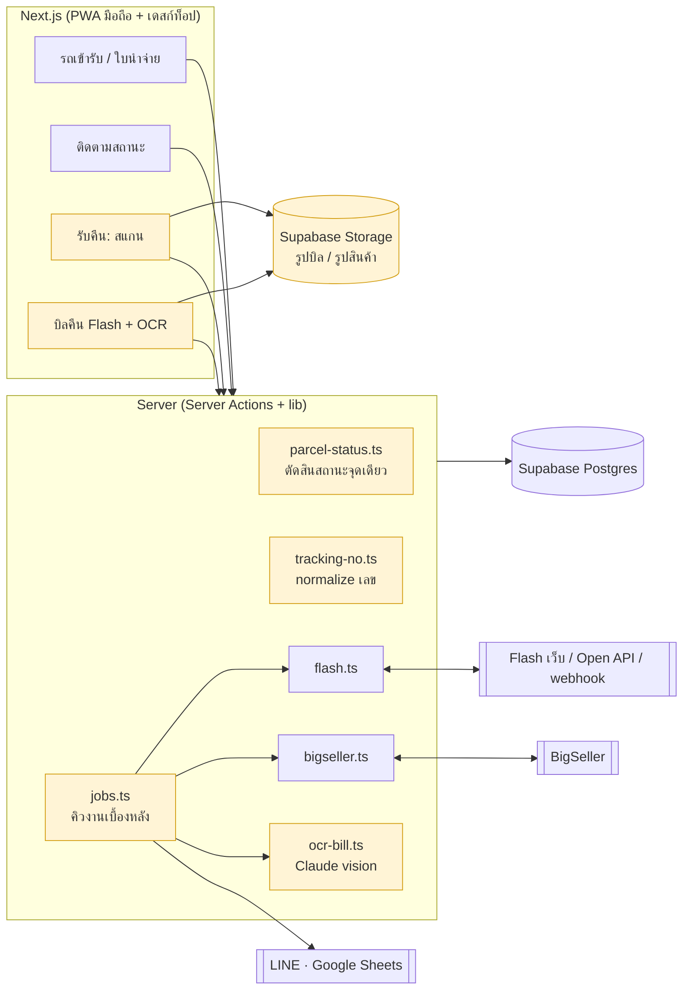
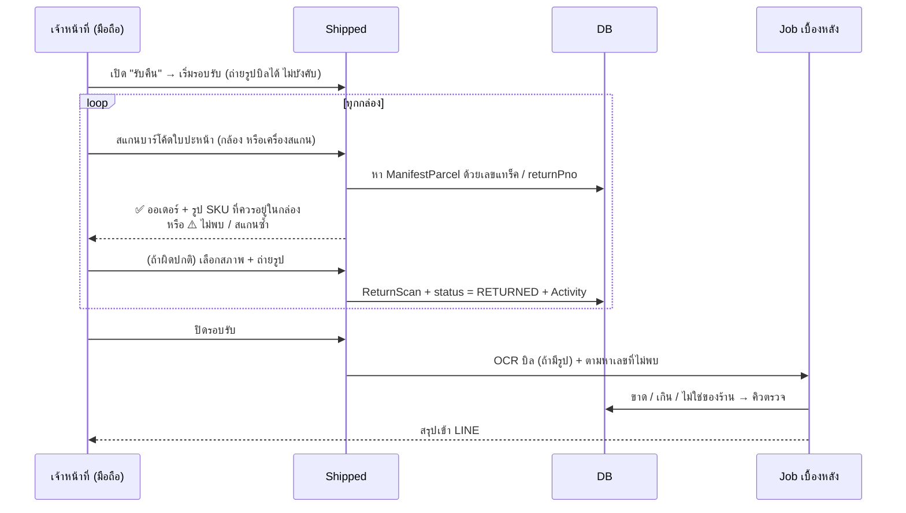

# Shipped + Flash Return Check — สถาปัตยกรรมรวม

> เอกสารนี้รวม 2 โปรเจกต์เป็นระบบเดียว
> - **Shipped** (โปรเจกต์นี้) — จดรถเข้ารับ, ใบนำจ่าย, ติดตามสถานะ Flash/BigSeller, LINE, Google Sheets
> - **flashReturnCheck** (`../flashReturnCheck`) — แนวคิดตรวจรับสินค้าตีกลับจาก Flash
>
> **ข้อสรุป:** ไม่ต้องสร้าง server ใหม่ตามที่เขียนไว้ใน `flashReturnCheck/architecture.md`
> ให้ทำ "รับคืน" เป็นโมดูลหนึ่งใน Shipped เพราะของที่ต้องใช้มีอยู่แล้วเกือบทั้งหมด
>
> อ่านจากโค้ดจริง ณ วันที่ 16 ต.ค. 2026 (Next 16.3 · Prisma 7 · Supabase Postgres)

---

## 1. ทำไมต้องรวม: ของที่ซ้ำกัน

| สิ่งที่ flashReturnCheck วางแผนจะสร้าง | Shipped มีอยู่แล้ว | ไฟล์ |
|---|---|---|
| Express server + Prisma + SQLite | Next.js + Prisma 7 + Supabase | `prisma/schema.prisma`, `src/lib/prisma.ts` |
| ตาราง User, role, AuditLog | `User`, `UserRole`, `Activity` | `src/lib/auth.ts`, `audit()` |
| Flash adapter (API / export) | Flash เว็บ + Open API + webhook + fallback อัตโนมัติ | `src/lib/flash.ts`, `flash-open.ts` |
| Import Excel จาก BigSeller | client BigSeller ผ่าน cookie ที่หมุนอายุเองได้ + ค้นออเดอร์ทีละ 50–100 | `src/lib/bigseller.ts`, `bigseller-session.ts` |
| ตารางพัสดุ + เลขแทร็ค | `ManifestParcel` (มีเลขแทร็ค, ออเดอร์, SKU, สถานะ Flash/BS อยู่แล้ว) | |
| ตารางรับของคืน | **`ReturnScan` มีใน schema แล้ว แต่ยังไม่มีหน้าจอใช้** | ถูกนับแค่ใน `src/app/page.tsx` |
| รายงานสรุป | รายงาน LINE ประจำวัน + อัปเดต Google Sheets | `src/lib/status-report.ts` |
| สถานะตีกลับ | `ParcelStatus.RETURNING / RETURNED`, `flashState = 7` | |

**ประเด็นสำคัญ:** พัสดุที่ตีกลับเกือบทั้งหมดคือของที่ร้านส่งออกไปเอง จึงมีอยู่ใน `ManifestParcel` แล้ว
ระบบรู้อยู่แล้วว่าเลขนี้เป็นออเดอร์ไหน, มี SKU อะไร และ Flash บอกว่าตีกลับหรือยัง
การเทียบ 3 แหล่งที่ออกแบบไว้ (บิล Flash, ของจริง, BigSeller) จึงเหลือแค่ **join ภายใน DB เดียว**
ไม่ต้อง import Excel และไม่ต้องยิง BigSeller ทีละเลข

---

## 2. ภาพรวมระบบหลังรวม


กล่องสีเหลือง = ของใหม่ ส่วนที่เหลือมีอยู่แล้ว

---

## 3. Flow รับคืนแบบใหม่ (ลดงานซ้ำของคน)

### เดิม: 5 ขั้น, 3 คน, ทำซ้ำหลายรอบ
1. เจ้าหน้าที่ติ๊กบนบิลกระดาษ
2. ส่งรูปบิลมา
3. OCR
4. เช็คกับ Flash ทีละเลข
5. เปิด BigSeller ดูทีละเลข

### ใหม่: สแกนครั้งเดียว ระบบทำต่อเอง



- **อยู่ในบิลแต่ไม่ได้สแกน** = ของขาด
- **สแกนแต่ไม่อยู่ในบิล** = ของเกิน
- **สแกนแต่หาออเดอร์ไม่เจอ** = ไม่ใช่ของร้าน หรือ Flash ออกเลขใหม่ตอนตีกลับ
- **ตีกลับตาม Flash แต่ยังไม่มีใครสแกนรับ** = ของค้างที่ Flash (แท็บ "ตีกลับ/มีปัญหา" ในหน้าติดตามคำนวณจาก `returns: { none: {} }` อยู่แล้ว **สแกนรับเมื่อไหร่ รายการหายจากแท็บนั้นเอง**)

**เหตุที่เปลี่ยนจากติ๊กกระดาษเป็นสแกน:** Shipped เป็น PWA อยู่แล้ว สแกนบาร์โค้ดได้ทั้งด้วยกล้องมือถือและด้วยเครื่องสแกนแบบ USB/Bluetooth (ทำงานเหมือนพิมพ์คีย์บอร์ด) เลขที่ได้ถูกต้อง 100% จึงตัดปัญหา OCR อ่านเลขผิดออกไปทั้งหมด
OCR ด้วย Claude เหลือหน้าที่เดียวคือ **อ่านบิลของ Flash เพื่อรู้ว่า Flash อ้างว่าส่งคืนอะไรบ้าง** แล้วเทียบกับที่สแกนจริง (เฟส 3)

### งานใน BigSeller
ระบบนี้อ่าน BigSeller ได้อย่างเดียว เพราะใช้ API ภายในของหน้าเว็บผ่าน cookie ยังไม่มีการเขียนกลับ
ดังนั้นหน้า "รับคืน" จะมีปุ่ม **คัดลอกเลขที่ต้องกดรับคืนใน BigSeller** (ใช้ `components/copy-trackings.tsx` ที่มีอยู่) และ job กลางคืนจะดึงสถานะ BigSeller มาเช็คว่ากดรับคืนครบหรือยัง

---

## 4. Schema ที่ต้องเปลี่ยน

```prisma
/// รอบรับของคืน 1 ครั้ง (Flash มาส่งคืน 1 รอบ = 1 บิล)
model ReturnBatch {
  id          String    @id @default(cuid())
  code        String    @unique          // R-20261016-01
  carrier     String    @default("Flash")
  openedBy    String?
  openedAt    DateTime  @default(now())
  closedAt    DateTime?
  billImages  String[]                   // path ใน Supabase Storage
  billTotal   Int?                       // ยอดรวมที่พิมพ์บนบิล
  billOcr     Json?                      // คำตอบดิบจาก Claude { rows:[{row,tracking,confidence}] }
  ocrAt       DateTime?
  /// สรุปหลังปิดรอบ { scanned, matched, missing, extra, unknown }
  summary     Json?
  scans       ReturnScan[]
  @@index([openedAt])
}

model ReturnScan {                        // ← มีอยู่แล้ว เพิ่มช่อง
  id          String   @id @default(cuid())
  trackingNo  String
  parcelId    String?
  batchId     String?                    // + รอบรับ
  source      String   @default("scan")  // + scan | manual | bill (อยู่ในบิลแต่ไม่ได้สแกน)
  result      String   @default("matched") // + matched | unknown | duplicate | missing | extra
  receivedAt  DateTime @default(now())
  receivedBy  String?
  condition   String?                    // NORMAL | BOX_DAMAGED | ITEM_DAMAGED | WRONG_ITEM | MISSING_PARTS
  photos      String[]                   // +
  note        String?
  resolvedAt  DateTime?                  // + คนตรวจปิดเคสแล้ว
  resolvedBy  String?
  parcel ManifestParcel? @relation(fields: [parcelId], references: [id], onDelete: SetNull)
  batch  ReturnBatch?    @relation(fields: [batchId], references: [id], onDelete: SetNull)
  @@unique([batchId, trackingNo])        // + สแกนซ้ำในรอบเดียวกันไม่เกิดแถวใหม่
  @@index([trackingNo])
  @@index([receivedAt])
  @@index([parcelId])
  @@index([result, resolvedAt])
}

model ManifestParcel {
  // ... ช่องเดิมทั้งหมด
  /// + เวลารถที่รับใบนี้ปิดงาน (สำเนาจาก Pickup) — แทน subquery manifest→pickups→pickup ที่ใช้ซ้ำ 5 ที่
  shippedAt  DateTime?
  /// + เลขที่ Flash ออกใหม่ตอนตีกลับ (webhook มี recentPno / origPno) — ให้สแกนใบปะหน้าขากลับแล้วเจอ
  returnPno  String?
  @@index([shippedAt, status])
  @@index([returnPno])
}

/// + คิวงานเบื้องหลังกลาง — แทน setInterval หลายตัว + ลูปที่หน้าเว็บต้องเปิดค้างไว้
model Job {
  id        String   @id @default(cuid())
  type      String   // flash.refresh | flash.pods | bs.statuses | bs.trackings | report.daily | ocr.bill | sheets.update
  key       String?  // กันงานซ้ำ เช่น "flash.refresh:pickup:<id>"
  payload   Json
  status    String   @default("queued") // queued | running | done | failed
  progress  Json?    // { done, total, message } — หน้าเว็บอ่านไปโชว์
  attempts  Int      @default(0)
  runAfter  DateTime @default(now())
  lockedAt  DateTime?
  error     String?
  createdBy String?
  createdAt DateTime @default(now())
  finishedAt DateTime?
  @@unique([key, status])
  @@index([status, runAfter])
}
```

Migration `shippedAt`: เติมค่าเก่าด้วย SQL ครั้งเดียว แล้วตั้งค่าใน `closePickup` (`updateMany` พัสดุของใบที่อยู่ในรถคันนั้น) ถ้ามีการ `reopenPickup` ให้ล้างค่ากลับ

---

## 5. โค้ดใหม่และโค้ดที่ต้องรวม

| ไฟล์ | หน้าที่ | ลดความซ้ำตรงไหน |
|---|---|---|
| `src/lib/tracking-no.ts` | `normalizeTracking()` ตัดช่องว่าง, ตัวพิมพ์ใหญ่, แก้ O↔0 / I↔1 (ใช้กับ OCR), `isFlashNo()` | ตอนนี้ `replace(/\s+/g,"").toUpperCase()` กระจายอยู่หลายไฟล์ (flash.ts, tracking.ts, bigseller.ts) |
| `src/lib/parcel-status.ts` | `decideStatus({ current, flash, bigseller, returnScan })` จุดเดียว | รวม `nextStatus()` ใน flash.ts กับ `statusFromBigSeller()` ใน bigseller.ts และกฎ "รับคืนแล้ว = RETURNED" ไว้ด้วยกัน ไม่ให้กฎขัดกัน |
| `src/lib/returns.ts` | `openBatch`, `scanReturn`, `closeBatch`, `reconcileBatch` | ใช้ `db`, `audit`, `notify` ตัวเดิม |
| `src/lib/ocr-bill.ts` | Claude vision + tool schema `record_bill` (ตามที่เขียนไว้ใน flashReturnCheck/architecture.md §5.1) | |
| `src/lib/jobs.ts` | `enqueue`, `runDue` (ใช้ `SELECT … FOR UPDATE SKIP LOCKED`), handler แยกตาม type | แทนลูปใน `instrumentation.ts` และ `refreshPickupsFlash` / `updateSentToSheets` ที่ต้องให้หน้าเว็บเรียกซ้ำเอง |
| `src/app/returns/page.tsx` | หน้าสแกน (มือถือ): ช่องรับเลขที่ autofocus + กล้อง, การ์ดผลล่าสุด, ปุ่มสภาพ | |
| `src/app/returns/[id]/page.tsx` | รอบรับ: รูปบิลคู่กับตาราง, แท็บ ตรง / ขาด / เกิน / ไม่พบ | ใช้ `DataTable`, `Panel` จาก `components/kit.tsx` |
| `src/app/api/cron/tick/route.ts` | เรียก `runDue()` สำหรับกรณี deploy แบบ serverless | รวม `/api/bigseller/keepalive` กับ `/api/line/daily` ไว้ใต้ทางเดียว (ทางเดิมเก็บไว้ได้) |

**ลบหรือไม่ต้องทำ:** server Express, การ import Excel ของ BigSeller, ตาราง User/AuditLog ชุดใหม่ และ Flash adapter ใหม่ ทั้งหมดใน `flashReturnCheck/architecture.md`

---

## 6. ทำให้ทำงานไวขึ้น (จากที่อ่านโค้ด)

DB อยู่บน Supabase และต่อผ่าน pooler ทุก query จึงเสียเวลาไปกลับระหว่างเครื่องกับ DB (โค้ดในหลายที่ก็คอมเมนต์ไว้แล้วว่า "DB อยู่ไกล") **ตัวที่ทำให้ช้าที่สุดจึงเป็นจำนวนรอบที่ยิงไป DB** ไม่ใช่การคำนวณ

| # | จุด | ตอนนี้ | แก้เป็น | ผล |
|---|---|---|---|---|
| 1 | `refreshFlashStatuses` (flash.ts) | `update` ทีละแถว พร้อมกันครั้งละ 8 → 400 ชิ้น ≈ 50 รอบไปกลับ | `UPDATE … FROM unnest(...)` ครั้งเดียว (pattern เดียวกับที่ `syncManifestStatuses` / `fetchShippers` ใช้อยู่แล้ว) | จาก ~50 รอบเหลือ 1–2 รอบ ใช้บ่อยที่สุดในระบบ (ทั้งหน้าติดตาม, ปิดรถ, รายงานประจำวัน) |
| 2 | `loadTracking` (tracking.ts) | เปิดหน้าครั้งเดียวยิง 7 query แต่ละ query มี `EXISTS manifest→pickups→pickup` | ใช้ช่อง `shippedAt` + index และนับทุกแท็บใน SQL เดียว (`COUNT(*) FILTER (WHERE …)`) | 7 query หนักเหลือ 2 query เบา |
| 3 | subquery "รถคันล่าสุดที่ปิดงาน" | เขียนซ้ำ 5 ที่ (tracking, status-report, sheets ฯลฯ) | อ่าน `shippedAt` แทน ส่วนทะเบียนรถค่อย join เฉพาะตอนแสดงผล | query สั้นลงและไม่ต้องดูแลโค้ดซ้ำ |
| 4 | `fetchFlashPods` | ยิง Flash ทีละเลข แล้ว `update` ทีละแถว | ยิงพร้อมกันครั้งละ 4–5 แล้วเขียน DB รวมครั้งเดียว | เร็วขึ้นตามจำนวนที่ยิงพร้อมกัน |
| 5 | `fetchManifestTrackings` | `duplicatesOf` ซ้อน 2 query และเติม `shippingMethod` ทีละแถว | ใช้ raw SQL query เดียว และเขียนรวมด้วย unnest | |
| 6 | `storeOnTruck` | ดึงเลขแทร็คของทุกใบที่เพิ่งจับคู่ตามลำดับ ภายใน request ของคนกด | ส่งเป็น job `bs.trackings` ให้หน้าเว็บตอบทันที | ลดเวลารอตอนจด manifest |
| 7 | ปุ่ม "ดึงสถานะ Flash ทั้งวัน" | หน้าเว็บต้องเปิดค้างไว้และเรียกซ้ำเองตาม `waitMs` (พัก 60 วินาทีต่อรอบ) | ส่งเป็น job `flash.refresh` ที่มีแถบ progress ปิดหน้าได้ งานยังทำต่อ | คนไม่ต้องรอหน้าจอ |
| 8 | Flash webhook | มีแล้ว แต่ระบบยังถามซ้ำทุก 30 นาทีด้วย | ถ้าเปิด webhook แล้ว ให้ถามเฉพาะชิ้นที่ไม่ได้ข่าวเกิน X ชั่วโมง | ลดการยิงหน้าเว็บ Flash ที่โดนจำกัด ~500 เลขต่อนาที |
| 9 | ที่ตั้ง server | ไม่ทราบ | รัน server ใน region เดียวกับ Supabase (ถ้า DB อยู่สิงคโปร์ ก็ deploy ที่สิงคโปร์) | ทุก query เร็วขึ้นทั้งระบบ ควรวัด latency ก่อน |

**ลำดับที่คุ้มที่สุด:** ข้อ 1 → 2/3 → 7 ข้อ 1 แก้ไฟล์เดียวและใช้ pattern ที่มีในโปรเจกต์อยู่แล้ว

ตัวอย่างข้อ 1:

```ts
// flash.ts — แทนลูป updates.push(...)
const ok = targets.flatMap((p) => { const f = byNo.get(p.trackingNo.toUpperCase()); return f?.found ? [{ p, f }] : []; });
if (ok.length) {
  await db.$executeRaw`
    UPDATE "ManifestParcel" AS m SET
      "flashState" = v.state, "flashStateText" = v.text, "flashLastRoute" = v.route,
      "flashRoutedAt" = v.routed, "flashRoutes" = v.routes::jsonb,
      "flashFetchedAt" = now(), "flashNotFound" = false,
      status = COALESCE(v.status::"ParcelStatus", m.status),
      "statusBy" = CASE WHEN v.status IS NULL THEN m."statusBy" ELSE 'Flash' END
    FROM unnest(${ok.map((x) => x.p.id)}::text[], ${ok.map((x) => x.f.state)}::int[],
                ${ok.map((x) => x.f.stateText)}::text[], ${ok.map((x) => x.f.lastRoute)}::text[],
                ${ok.map((x) => x.f.routedAt)}::timestamptz[], ${ok.map((x) => JSON.stringify(x.f.routes))}::text[],
                ${ok.map((x) => nextStatus(x.p.status, x.f.state))}::text[])
      AS v(id, state, text, route, routed, routes, status)
    WHERE m.id = v.id`;
}
// เลขที่ไม่พบ → updateMany ครั้งเดียว
if (notFoundIds.length) await db.manifestParcel.updateMany({ where: { id: { in: notFoundIds } }, data: { flashFetchedAt: now, flashNotFound: true } });
```

---

## 7. งานเบื้องหลังจุดเดียว (`jobs.ts`)

ตอนนี้งานเบื้องหลังกระจายอยู่ 3 แบบ:
1. `setInterval` ใน `instrumentation.ts` (keep-alive ของ BigSeller, รายงานประจำวันที่ยิงกลับเข้า `/api/line/daily` ของตัวเอง)
2. `after()` หลังตอบหน้าเว็บ (LINE ตอนปิดรถ)
3. หน้าเว็บเรียก server action ซ้ำเป็นรอบ ๆ (`refreshPickupsFlash`, `updateSentToSheets`, `exportPickupsToSheets`)

ให้รวมเป็น **คิวเดียวในตาราง `Job`** ดังนี้
- `instrumentation.ts` เหลือ timer ตัวเดียว ทุก 15 วินาทีเรียก `runDue()` (ถ้า deploy แบบ serverless ให้ cron เรียก `/api/cron/tick` แทน)
- งานที่ทำเป็นรอบ (keep-alive, รายงานประจำวัน, ดึงสถานะคืน) = แถวใน `Job` ที่ทำเสร็จแล้วตั้ง `runAfter` รอบถัดไปเอง
- หน้าเว็บกดปุ่มแล้วได้ `jobId` กลับทันที จากนั้นอ่าน `progress` มาโชว์
- `key` กันไม่ให้คนสองคนกดงานเดียวกันซ้ำ
- งานที่ยิง Flash (โดนจำกัด ~500 เลขต่อนาที) และ BigSeller (`REQUEST_DELAY_MS`) ทำทีละ 1 job ต่อ type เพื่อไม่ให้ยิงชนกันเอง

`after()` ยังใช้ได้กับงานเล็กที่ไม่ต้องรอผล เช่นส่ง LINE ข้อความเดียว

---

## 8. หน้าจอ

| เส้นทาง | สถานะ | หมายเหตุ |
|---|---|---|
| `/returns` | ใหม่ | หน้าสแกนบนมือถือ: เลขล่าสุดตัวใหญ่, ✅/⚠️ สีและเสียงต่างกัน, ปุ่มสภาพ 5 แบบ, ถ่ายรูป |
| `/returns/[id]` | ใหม่ | รอบรับ + รูปบิล + แท็บ ตรง / ขาด / เกิน / ไม่พบ + คัดลอกเลขไปทำใน BigSeller |
| `/tracking` | แก้ | เพิ่มแท็บ **"รับคืนผิดปกติ"** (ReturnScan ที่ `result ≠ matched` และยังไม่ resolve) |
| `/parcels/[id]` | แก้ | แสดงประวัติรับคืน (เวลา, คนรับ, สภาพ, รูป) |
| `/` | แก้ | การ์ด "ตีกลับรับวันนี้" ที่มีอยู่แล้ว ทำเป็นลิงก์ไป `/returns` |
| `/sync` | แก้ | แสดงคิวงาน (Job) ล่าสุด ข้างประวัติ `SyncRun` |
| เมนู | แก้ | เพิ่ม "รับคืน" ใน `components/nav.tsx` |

ใช้ token สีและ component ตาม `DESIGN.md` และ `components/kit.tsx` ที่มีอยู่ (สีตีกลับใช้โทน `back` = warning ตาม `flash-state.ts`)

---

## 9. แผนทำ

| เฟส | งาน | ขนาดงาน | ได้อะไร |
|---|---|---|---|
| **0. ทำให้เร็วขึ้น** | ข้อ 1, 4, 5 ในหัวข้อ 6 (bulk update) | เล็ก ไม่แตะ schema | หน้าติดตาม / ปิดรถ / รายงานเร็วขึ้นทันที |
| **1. รับคืนด้วยการสแกน** | `tracking-no.ts`, `parcel-status.ts`, migration `ReturnBatch` + ช่องใหม่ใน `ReturnScan`, หน้า `/returns` | กลาง | เลิกติ๊กกระดาษและเลิกเช็คทีละเลข |
| **2. คิวงาน + shippedAt** | ตาราง `Job`, `jobs.ts`, ย้ายงานใน instrumentation และลูปของหน้าเว็บ, ช่อง `shippedAt` + ข้อ 2/3 | กลาง | หน้าเว็บไม่ต้องเปิดค้าง, query เบาลง |
| **3. OCR บิล Flash** | `ocr-bill.ts` + เก็บรูปใน Supabase Storage + เทียบ ขาด/เกิน | กลาง | เห็นของที่ Flash อ้างว่าคืน แต่ร้านไม่ได้รับ |
| **4. เก็บกวาด** | รวม `/api/*` ที่เป็น cron, ลบโค้ด normalize ที่ซ้ำ, ปิด `flashReturnCheck` เป็นเอกสารอ้างอิง | เล็ก | |

---

## 10. สิ่งที่ยังต้องยืนยัน

- **Flash ออกเลขใหม่ตอนตีกลับไหม** โค้ด webhook รับ `recentPno` / `origPno` อยู่แล้ว ซึ่งบอกเป็นนัยว่าน่าจะออก ต้องเอาพัสดุตีกลับจริงมาสแกน 2–3 ชิ้นเพื่อดูว่าใบปะหน้าขากลับเป็นเลขอะไร
- **บิลคืนของ Flash** มีบาร์โค้ดหรือยอดรวมไหม (ขอรูปตัวอย่าง) ถ้ามีบาร์โค้ดของแต่ละชิ้น อาจไม่ต้องใช้ OCR เลย
- **BigSeller** มี endpoint สำหรับกดรับคืนไหม ตอนนี้ระบบอ่านได้อย่างเดียว ถ้าจะเขียนกลับต้องดักดู network request ก่อน และระวังว่าเป็น API ภายในของหน้าเว็บที่อาจเปลี่ยนได้
- **ระยะทางจาก server ถึง Supabase** ควรวัด latency ของ query ง่าย ๆ ก่อนตัดสินใจย้ายที่ deploy
